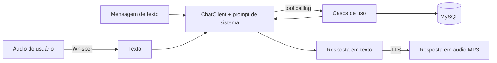
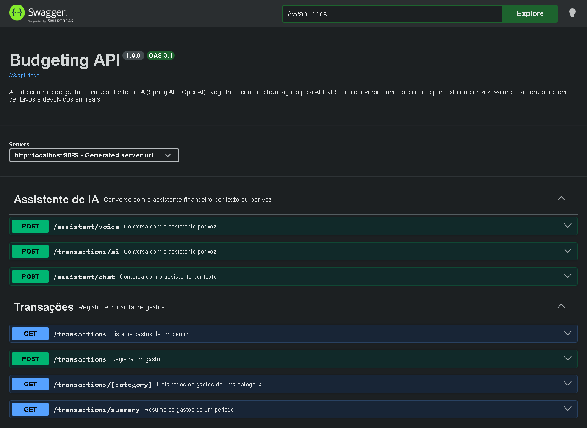

# Budgeting — Controle de gastos por voz com Spring AI

[](https://github.com/VitorCamprubi/budgeting-spring-ai/actions/workflows/ci.yml)


Projeto final do **Bootcamp CI&T – Java com IA (DIO)**: o desafio **"Desenvolvendo sua API Inteligente com Reconhecimento de Fala e Spring Boot"**.

É uma API de controle de gastos em que você registra e consulta despesas **falando** ou **escrevendo** para um assistente. O áudio é transcrito, o modelo de linguagem decide qual caso de uso executar (*tool calling*) e a resposta volta em texto ou em áudio. A IA usa os mesmos casos de uso da API REST: as regras de negócio não ficam espalhadas no prompt.

> Parti do projeto construído nas aulas e implementei as melhorias descritas em [Melhorias implementadas](#-melhorias-implementadas). Cada uma foi entregue em um Pull Request com CI.

---

## Sumário

- [O que o projeto faz](#-o-que-o-projeto-faz)
- [Melhorias implementadas](#-melhorias-implementadas)
- [Tecnologias](#-tecnologias)
- [Arquitetura](#-arquitetura)
- [Como executar](#-como-executar)
- [Como testar o fluxo principal](#-como-testar-o-fluxo-principal)
- [Endpoints](#-endpoints)
- [Testes automatizados](#-testes-automatizados)
- [O que aprendi](#-o-que-aprendi)
- [Próximos passos](#-próximos-passos)

---

## 🎯 O que o projeto faz



Exemplos do que dá para pedir ao assistente:

- *"Gastei 80 reais no mercado"* → registra o gasto em `GROCERIES` com a data de hoje.
- *"Ontem paguei 45 e 90 na farmácia"* → descobre a data de ontem e registra em `PHARMA`.
- *"Quanto eu gastei esse mês?"* → calcula o período e responde com o total e as categorias com mais gastos.
- *"Quais foram meus gastos com carro em outubro?"* → lista os gastos de `AUTO` no período.

Tudo isso também está disponível pela API REST tradicional, sem IA.

---

## 🚀 Melhorias implementadas

O desafio sugeria algumas formas de evoluir o projeto base. Estas foram as que implementei:

| Sugestão do desafio | O que fiz | PR |
|---|---|---|
| Criar testes para os principais fluxos | Os testes passaram a rodar **sem MySQL local e sem chave da OpenAI** (Testcontainers). Hoje são 55 testes de domínio, casos de uso, controllers, repositório e tools, mais o CI no GitHub Actions | [#1](https://github.com/VitorCamprubi/budgeting-spring-ai/pull/1) |
| Adicionar validações antes de salvar uma transação | Regras no domínio (descrição, valor > 0, categoria e data), Bean Validation na API e erros padronizados com `ProblemDetail` (400, 422, 502) em vez de 500 | [#2](https://github.com/VitorCamprubi/budgeting-spring-ai/pull/2) |
| Adicionar novos tipos de consulta financeira | Data na transação, **consulta por período** e **resumo de gastos por categoria** | [#3](https://github.com/VitorCamprubi/budgeting-spring-ai/pull/3) |
| Criar novas ferramentas para o Tool Calling | Novas tools `list-transactions-by-period`, `summarize-expenses` e `current-date` | [#3](https://github.com/VitorCamprubi/budgeting-spring-ai/pull/3) |
| Melhorar as respostas geradas pela IA | Prompt de sistema reescrito: quando usar cada tool, valores em centavos, perguntar quando faltar informação e respostas curtas, prontas para virar áudio | [#3](https://github.com/VitorCamprubi/budgeting-spring-ai/pull/3) |
| Melhorar os endpoints REST | `POST /assistant/chat` (conversa por **texto**, sem gravar áudio), novos `GET` de consulta e tratamento de erros | [#3](https://github.com/VitorCamprubi/budgeting-spring-ai/pull/3), [#4](https://github.com/VitorCamprubi/budgeting-spring-ai/pull/4) |
| Documentar melhor como usar a API | **Swagger UI** (springdoc), exemplos prontos em `http/budgeting-api.http` e este README | [#4](https://github.com/VitorCamprubi/budgeting-spring-ai/pull/4), [#5](https://github.com/VitorCamprubi/budgeting-spring-ai/pull/5) |
| Propor uma nova ideia de assistente | Proposta do **assistente de metas de orçamento**, em [Próximos passos](#-próximos-passos) | — |

### 🐞 Bug que encontrei no caminho

O valor é guardado em **centavos** (`8000` = R$ 80,00), mas a resposta não dividia por 100: R$ 80,00 aparecia como `8000.0`, e o assistente chegava a responder *"você gastou 8000 reais"*. Corrigi a conversão e troquei `double` por `BigDecimal`, que é o tipo certo para dinheiro. Um teste cobre esse caso (`TransactionOutputTest`).

### ⬆️ Atualizações

- **Spring AI** `2.0.0-M4` (milestone) → `2.0.2` (versão estável) e **Spring Boot** `4.0.5` → `4.0.9`. Na 2.0 estável, o Spring AI passou a usar o SDK oficial da OpenAI. A classe `OpenAiApi` deixou de existir e precisei adaptar os testes de integração.
- Refatoração: a orquestração de IA saiu do `TransactionController` e foi para o `BudgetAssistant`. O controller REST ficou só com HTTP e passou a ser testável isoladamente.

---

## 🛠 Tecnologias

| Categoria | Tecnologia |
|---|---|
| Linguagem | Java 25 |
| Framework | Spring Boot 4.0 (Web MVC, Validation, Data JPA) |
| IA | Spring AI 2.0 + OpenAI (`gpt-4o-mini`, `whisper-1`, `gpt-4o-mini-tts`) |
| Banco | MySQL 9 (Docker Compose em dev, Testcontainers nos testes) |
| Documentação | springdoc-openapi (Swagger UI) |
| Testes | JUnit 5, Mockito, AssertJ, MockMvc, Testcontainers |
| CI | GitHub Actions |
| Build | Gradle |

---

## 🏛 Arquitetura

O projeto segue as camadas de DDD usadas em toda a trilha do bootcamp:

```text
src/main/java/dio/budgeting
├── domain/                 -> Transaction, Category, DateRange, TransactionRepository e exceções de domínio
├── application/            -> casos de uso (também expostos como tools da IA)
│   ├── PersistTransactionUseCase
│   ├── ListTransactionsByCategoryUseCase
│   ├── ListTransactionsByPeriodUseCase
│   └── SummarizeExpensesUseCase
└── infrastructure/
    ├── ai/                 -> BudgetAssistant (ChatClient, transcrição e voz) e DateTimeTools
    ├── http/               -> controllers, requests/responses e GlobalExceptionHandler
    ├── persistence/        -> entidade e repositórios JPA
    └── config/             -> Clock e OpenAPI
```

Algumas decisões que tomei:

- **A IA é um adaptador.** O `BudgetAssistant` fica em `infrastructure` porque depende do Spring AI. Os casos de uso não sabem se foram chamados pela API REST ou pelo modelo.
- **Validação no domínio.** A regra "valor maior que zero" está na `Transaction`, então vale também quando quem cria a transação é a IA.
- **Dinheiro em centavos (`long`)** no domínio e `BigDecimal` na saída, para evitar erros de arredondamento.
- **`Clock` injetado** em vez de `LocalDate.now()`. Assim os testes conseguem fixar o "hoje".
- **Uma tool para a data atual.** O modelo não sabe que dia é hoje, e sem isso "esse mês" vira chute.

---

## ▶️ Como executar

### Pré-requisitos

- JDK 17+ para rodar o Gradle (o JDK 25 do projeto é baixado automaticamente)
- Docker em execução (o MySQL sobe sozinho via Docker Compose)
- Uma chave da OpenAI, **só para os endpoints de IA**. A API REST de transações funciona sem ela.

### 1. Configure a chave da OpenAI (opcional)

A API da OpenAI é paga à parte do ChatGPT, com crédito pré-pago a partir de US$ 5. Este projeto usa modelos baratos, então testar custa centavos.

```bash
# Linux/macOS
export OPENAI_API_KEY="sua-chave"

# Windows (depois, reabra o terminal ou a IDE)
setx OPENAI_API_KEY "sua-chave"
```

### 2. Suba a aplicação

```bash
git clone https://github.com/VitorCamprubi/budgeting-spring-ai.git
cd budgeting-spring-ai
./gradlew bootRun
```

A aplicação sobe em `http://localhost:8080`, e o Spring Boot inicia o MySQL do `compose.yml` automaticamente.

- Swagger UI: http://localhost:8080/swagger-ui/index.html
- Contrato OpenAPI: http://localhost:8080/v3/api-docs



---

## 🧪 Como testar o fluxo principal

### 1. Testes automatizados (sem chave e sem banco local)

```bash
./gradlew test
```

Só precisa do Docker em execução. Os testes `*IT`, que chamam a OpenAI de verdade, rodam apenas quando `OPENAI_API_KEY` está definida.

### 2. API REST (sem IA)

Use o Swagger UI ou o arquivo [`http/budgeting-api.http`](http/budgeting-api.http), que roda direto no IntelliJ ou no VS Code.

```bash
# Registra um gasto (valor em centavos; sem "date", vale a data de hoje)
curl -X POST http://localhost:8080/transactions \
  -H "Content-Type: application/json" \
  -d '{"description":"Compra no mercado","category":"GROCERIES","amount":18990,"date":"2026-10-03"}'

# Resumo do mês
curl "http://localhost:8080/transactions/summary?from=2026-10-01&to=2026-10-31"
```

Resposta real do resumo, depois de cadastrar cinco gastos de exemplo:

```json
{
  "from": "2026-10-01",
  "to": "2026-10-31",
  "total": 594.50,
  "transactionCount": 5,
  "byCategory": [
    { "category": "GROCERIES",  "total": 263.10, "transactionCount": 2 },
    { "category": "AUTO",       "total": 220.00, "transactionCount": 1 },
    { "category": "RESTAURANT", "total": 65.50,  "transactionCount": 1 },
    { "category": "PHARMA",     "total": 45.90,  "transactionCount": 1 }
  ]
}
```

Erro de validação (`POST /transactions` com `{"description":"","amount":0}`):

```json
{
  "title": "Dados inválidos",
  "status": 400,
  "detail": "Um ou mais campos são inválidos",
  "instance": "/transactions",
  "errors": {
    "description": "A descrição é obrigatória",
    "amount": "O valor deve ser maior que zero (informado em centavos)",
    "category": "A categoria é obrigatória"
  }
}
```

### 3. Assistente por texto (requer `OPENAI_API_KEY`)

```bash
curl -X POST http://localhost:8080/assistant/chat \
  -H "Content-Type: application/json" \
  -d '{"message":"Gastei 45 reais e 90 centavos na farmácia hoje"}'

curl -X POST http://localhost:8080/assistant/chat \
  -H "Content-Type: application/json" \
  -d '{"message":"Quanto eu gastei esse mês?"}'
```

Sem a chave configurada, esses endpoints respondem `502` com a mensagem *"Verifique a chave OPENAI_API_KEY"*, e o resto da API continua funcionando.

### 4. Assistente por voz (requer `OPENAI_API_KEY`)

```bash
curl -X POST http://localhost:8080/assistant/voice \
  -F "file=@src/test/resources/audio/recording-1.m4a" \
  --output resposta.mp3
```

O arquivo `resposta.mp3` traz a resposta falada do assistente. O endpoint original do curso, `POST /transactions/ai`, continua funcionando.

> 💡 **Windows:** se mandar texto com acento pelo `curl` no terminal, ele pode chegar em outra codificação e a API responde 400 (JSON inválido). Use o Swagger, o arquivo `.http` ou `--data-binary @arquivo.json` salvo em UTF-8.

---

## 📚 Endpoints

| Método | Endpoint | Descrição |
|---|---|---|
| `POST` | `/transactions` | Registra um gasto (`amount` em centavos, `date` opcional) |
| `GET` | `/transactions?from=&to=&category=` | Gastos de um período (padrão: mês atual), com filtro opcional |
| `GET` | `/transactions/summary?from=&to=` | Total do período e total por categoria |
| `GET` | `/transactions/{category}` | Todos os gastos de uma categoria |
| `POST` | `/assistant/chat` | Conversa com o assistente por texto |
| `POST` | `/assistant/voice` | Conversa por voz (`multipart/form-data`, campo `file`), responde MP3 |
| `POST` | `/transactions/ai` | Endpoint de voz original (mantido por compatibilidade) |

Categorias: `GROCERIES` (mercado), `PHARMA` (farmácia), `AUTO` (carro), `RESTAURANT` (restaurantes), `LEISURE` (lazer) e `OTHER` (outros).

### Tools disponíveis para a IA

| Tool | O que faz |
|---|---|
| `persist-transaction` | Registra um gasto |
| `list-transactions-by-category` | Lista os gastos de uma categoria |
| `list-transactions-by-period` | Lista os gastos de um período, com filtro opcional de categoria |
| `summarize-expenses` | Total e total por categoria de um período |
| `current-date` | Informa a data de hoje, para o modelo calcular "esse mês", "ontem" etc. |

---

## ✅ Testes automatizados

| Teste | O que valida |
|---|---|
| `TransactionTest`, `DateRangeTest` | Regras de domínio (testes parametrizados) |
| `PersistTransactionUseCaseTest`, `ListTransactionsByPeriodUseCaseTest`, `SummarizeExpensesUseCaseTest` | Casos de uso com Mockito e `Clock` fixo |
| `TransactionOutputTest` | Conversão de centavos para reais |
| `TransactionControllerTest`, `AssistantControllerTest` | Endpoints com `@WebMvcTest`: status, validação e erros |
| `JpaTransactionRepositoryTest` | Consultas JPA contra um **MySQL real** (Testcontainers) |
| `BudgetToolsTest` | Chama cada tool com JSON, como o modelo faz, **sem a OpenAI** |
| `SystemPromptTest` | O template do prompt renderiza sem erro |
| `BudgetingApplicationTests` | Contexto completo e documentação OpenAPI |
| `*IT` | Integração real com a OpenAI (chat, tools, transcrição e voz); só rodam com a chave |

O GitHub Actions roda `./gradlew build` a cada push e Pull Request.

---

## 💡 O que aprendi

- **Spring AI na prática:** a diferença entre `ChatModel` (baixo nível) e `ChatClient` (API fluente com prompt de sistema e tools), e como `TranscriptionModel` e `TextToSpeechModel` fecham o ciclo voz → texto → voz.
- **Tool calling bem feito depende de boas descrições.** O modelo escolhe a tool pelo nome, pela descrição e pelos parâmetros. Explicar "valor em centavos" e dar exemplos na `@ToolParam` fez diferença.
- **O modelo não sabe que dia é hoje.** Uma tool simples de data atual resolve perguntas como "esse mês".
- **Testar IA sem gastar com IA:** quase tudo pode ser testado sem chamar a OpenAI. As tools são testadas chamando os callbacks com JSON, e os controllers com o assistente mockado. Só os testes `*IT` usam a API de verdade.
- **Testcontainers** deixa os testes independentes da máquina: o MySQL sobe sozinho tanto no meu computador quanto no CI.
- **Problem Details (RFC 9457)** para padronizar erros, e diferenciar 400 (requisição inválida), 422 (regra de negócio) e 502 (serviço externo).
- **Migração de versão:** atualizar de milestone para versão estável quebrou a API do `OpenAiApi`, e precisei ler o que mudou. No Spring Boot 4, os *test slices* (`@WebMvcTest`, `@DataJpaTest`) viraram dependências separadas.
- **Fluxo de trabalho:** uma branch e um Pull Request por melhoria, com CI validando antes do merge.

### Conexão com a trilha do bootcamp

Este projeto junta conceitos dos módulos anteriores:
- **DDD** (camadas, value objects como `DateRange`, repository pattern).
- **Spring Web** (validação, tratamento de erros, documentação da API).
- **Spring Data** (consultas derivadas, Docker Compose, Testcontainers).

---

## 🔭 Próximos passos

### Nova ideia de assistente: metas de orçamento

Usando a mesma base técnica, o próximo passo seria um **assistente de metas**:

- *"Quero gastar no máximo 600 reais com mercado por mês"* → tool `set-budget-limit` grava um limite por categoria.
- Ao registrar um gasto, o assistente avisa: *"Pronto, registrei 80 reais em mercado. Você já usou 85% da sua meta do mês."*
- *"Como estão minhas metas?"* → tool `check-budget-status` compara o resumo do mês com os limites.

O domínio ganharia um `Budget(category, monthlyLimit)`, e o `SummarizeExpensesUseCase` já entrega os totais por categoria de que essa feature precisa.

### Outras evoluções (roadmap apresentado nas aulas)

- **Segurança com Spring Security e JWT**, para cada usuário ver só os próprios gastos (módulo de Spring Security).
- **Integração externa com OpenFeign**, por exemplo conversão de moeda para gastos em viagem (módulo de OpenFeign).
- **MCP Server**, expondo os casos de uso via Model Context Protocol para outros clientes de IA.
- **Microsserviços de áudio** separados para transcrição e TTS.

---

## 👤 Autor

**Vitor Camprubi**: formado em Gestão de TI e estudando desenvolvimento back-end com Java, Spring Boot e IA.

[](https://github.com/VitorCamprubi)

Projeto desenvolvido no **Bootcamp CI&T – Java com IA**, da [DIO](https://www.dio.me/), a partir do projeto base construído nas aulas.
